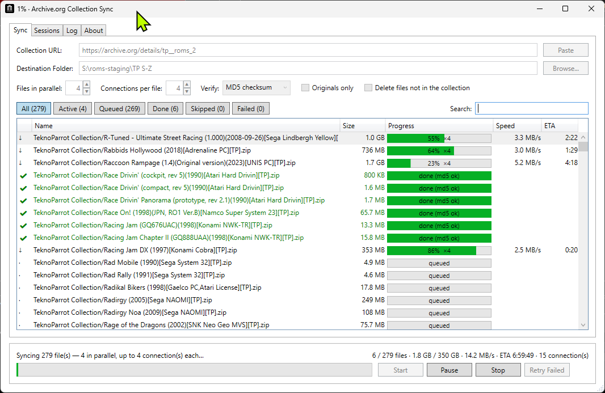

# Archive.org Bulk Downloader: download entire Internet Archive collections, fast and resumable

[](https://github.com/dsync89/archive-org-bulk-downloader/actions/workflows/build.yml)
[](https://github.com/dsync89/archive-org-bulk-downloader/releases/latest)
[](https://github.com/dsync89/archive-org-bulk-downloader/releases)

**Archive.org Bulk Downloader** is a free, open-source Windows app (GUI, no command line). It downloads and syncs whole
**archive.org / Internet Archive** collections and items to a local folder:
- **parallel downloads**, with several files at once and several connections per file;
- **resume** after pause, crash or reboot;
- **MD5 checksum verification**;
- **Sync**, which shows what the uploader added, removed, renamed or replaced since your last download, and applies it;
- a live, TeraCopy-style file list with speed and ETA.

Paste a collection URL, pick a folder and press Start.

**[⬇ Download the latest release (Windows .exe)](https://github.com/dsync89/archive-org-bulk-downloader/releases/latest)**



> Forked from [Archive.org Collection Sync](https://github.com/jasonunbrokensoftware/ArchiveOrgCollectionSync) by
> Jason / Unbroken Software, LLC. See [Credits](#credits).

## Features

- **Bulk download a whole archive.org collection or item.** Every file listed in the item's `_files.xml` is included,
  and nested folders are kept.
- **Multi-connection (segmented) downloads.** Large files are split into HTTP `Range` segments and fetched over
  several connections at once, like IDM or aria2.
- **Parallel downloads.** Several files download at the same time.
- **Pick which files to download, like JDownloader's LinkGrabber.**
  - **Scan** lists the collection without downloading. Tick or untick files, then press **Start**.
  - Quick buttons: All, None, Invert, Visible (whatever the filter and search show), Highlighted, Only Missing.
  - Space toggles the highlighted rows. Your picks are remembered for the next scan.
- **Resume interrupted downloads.** Pause, crash, network drop or closing the app keeps `.part` files, and the next
  run continues where it stopped.
- **MD5 checksum verification** against archive.org's own checksums. A corrupt download never overwrites a good file.
- **Know when an item changed: Sync with a diff.** Every download link (collection + folder) keeps snapshots of the
  item's file list. **⟳ Sync** compares your last snapshot with archive.org now and lists every file that was
  **+ added, − removed, ~ renamed, ⇄ moved or \* changed** (new checksum). For each file it also shows whether the copy
  on disk matches the old version, the new one or neither. Then it applies the changes you tick:
  - renamed files are renamed on disk instead of downloaded again;
  - replaced and removed files move to `_removed\<date>\` (never deleted), with an `undo.json`.
- **Sync / mirror mode:**
  - re-running skips files that are already correct;
  - files with the wrong size or checksum download again;
  - optionally, files that are no longer in the collection are deleted.
- **TeraCopy-style progress.** Each file shows status, size, a progress bar, speed and ETA, with filters (Active /
  Queued / Done / Skipped / Failed) and search. Overall speed and ETA show in the bottom bar and on the taskbar.
- **Links tab: every collection you sync, with its history.**
  - **Check all for updates** asks archive.org about every link at once and flags it: `●` up to date, `▲` changed
    since your last run or snapshot, `?` not synced yet, `✖` the folder or item is gone.
  - **Runs** lists past sessions with Resume, Retry Failed, Re-run and Export CSV.
  - **Snapshots** lists every saved file list with what changed against the one before.
  - **Diff** compares any two snapshots, or a snapshot with archive.org now.
  - **File history** lists every version of one file: size, MD5, SHA-1, upload date, which run fetched it, whether it
    is the copy on disk, and the copies archive.org kept of replaced versions.
  - **Relocate** points a link at the folder you moved its files to; **Forget** deletes its history.
- **Detailed log** with levels, search, copy and save, plus a log file per session.
- **Polite to archive.org.** It retries with backoff and honours `Retry-After` on HTTP 429/503.
- **"Originals only"** skips derivative files (thumbnails, torrents, metadata) that archive.org generates.

## Download and install

1. Download `ArchiveOrgBulkDownloader-<version>-win-x64.exe` from
   [Releases](https://github.com/dsync89/archive-org-bulk-downloader/releases/latest).
2. Make sure the [.NET Desktop Runtime](https://dotnet.microsoft.com/download) 6.0 or newer is installed; 8.0 or 9.0
   is fine. Windows will offer to install it if it's missing.
3. Run the exe. No installer, no admin rights.

## How to use

1. Copy the collection or item URL from archive.org, either `https://archive.org/details/<identifier>` or
   `https://archive.org/download/<identifier>`.
2. Paste it, choose a destination folder and press **Start** to download everything. Or press **Scan** first, untick
   what you don't want, then press **Start**.
3. Watch the file list. **Pause** keeps partial files; **Resume** continues; **Retry Failed** re-tries only failures.
4. Later, press **⟳ Sync** to see what changed on archive.org since then. A banner appears by itself when the item was
   updated after your last Sync. **Links ▾** lists every collection + folder you've downloaded, so you can switch
   between them.

### Options

| Option | Default | What it does |
|---|---|---|
| Files in parallel | 4 | 1–16 files downloading at the same time. |
| Connections per file | 4 | 1–16 ranged connections for files of 32 MB or more; smaller files use one. |
| Verify | MD5 checksum | **Size only** is much faster when re-checking a big existing folder. |
| Originals only | on | Skip archive.org-generated derivatives (thumbnails, torrents, `_meta.xml`…). |
| Delete files not in the collection | off | Mirror mode: delete extra files under the destination (in-progress `.part` files are kept). |
| Keep re-zipped files | on | Sync: when archive.org lists a changed zip that provably holds the same files as yours, keep your copy instead of downloading it again. Off = always replace changed files. |

5. On the **Links** tab, press **Check all for updates** now and then to see which of your collections changed on
   archive.org.

## FAQ

### How do I download an entire archive.org collection at once?

Paste the item's `https://archive.org/details/<identifier>` URL, pick a folder and press **Start**. The app reads the
item's file list and downloads every file, keeping nested folders.

### Why are archive.org downloads so slow, and how do I make them faster?

archive.org usually limits the speed of a single connection, so one big file on one connection is slow even on a fast
line. Raise **Connections per file** to split large files over several connections, and **Files in parallel** to
download more files at once.

Start with the defaults (4 × 4) and go up gradually. Beyond a few connections per file your own bandwidth is usually
the limit, and archive.org may throttle very aggressive clients.

### How many connections per file should I use?

4 is a good default; 6 is a sensible maximum for most people. The total number of connections is files ×
connections per file. Watch the speed in the bottom bar and stop increasing once it stops going up.

### Can I resume an interrupted archive.org download?

Yes. Partial data is kept in `<file>.part` with a small `<file>.part.json` progress map. Press **Resume**, use
**Sessions → Resume** after restarting the app, or simply run the same URL again.

### How do I keep a local copy in sync with an archive.org collection?

Press **Start** again with the same URL and folder. It works like JDownloader:
- Every file that passed verification is remembered. If it's unchanged locally and on archive.org, it's skipped
  instantly with no re-hashing.
- Partial downloads resume.
- Failed and missing files download.
- Files changed on archive.org download again.
- If the last session for that folder is unfinished, Start asks whether to continue it or begin a new scan.
- With **Delete files not in the collection**, your folder mirrors the collection exactly.

Use **Verify All** to MD5-check every existing file again, for example if you suspect disk corruption.

### How do I find out if files in an archive.org item were silently updated?

Press **⟳ Sync**. Uploaders of big collections (ROM sets, for example) often replace files without saying so: same name,
new checksum. Sync compares the file list from your last download with archive.org now:

1. **Checking.** It asks archive.org when the item last changed, which is a few bytes. When nothing changed since your
   last Sync, it stops there. Otherwise it reads the file list and stats your folder. Each step shows its progress, and
   **Run in background** hides the window to a status strip.
2. **Review.** It shows every change with its old (A) and new (B) size, checksum and upload date, plus a **Local**
   column:
   - `= A ✔` means your copy is the old version and was hashed;
   - `= B` means you already have the new one;
   - `? unknown` means the copy was never verified; **Hash unknown** fixes that.
   Untick anything you want left alone.
3. **Confirm.** It lists every rename, move and download, and warns first: files removed upstream, local copies that
   match neither version, free space, and a suspiciously large change.
4. **Apply.** Renames happen on disk, so there is no download for them. Replaced and removed files move to
   `_removed\<date>\`. Then the normal download fetches the new versions, skipping unchanged files without hashing.

You don't need to re-hash your existing downloads first. The first Sync of a folder you downloaded with an earlier
version takes its baseline from the folder's `<identifier>_files.xml` and your old sessions. A file that kept the size
it had when a session verified it, and wasn't written after that session ended, counts as verified.

### Why does Sync leave some changed files unticked (≡ re-zipped only)?

Because the files inside them are the same as yours: archive.org lists a new MD5 only because the zip was rebuilt.
ROM collections are often re-packed in bulk when the uploader updates their tools (RomVault, TorrentZip) or DAT. For
example, tp-roms_0 changed 235 zips in one day in November 2026, and 225 of them held exactly the same ROMs.

How Sync proves it, without downloading:
- It reads archive.org's index of the new zip with a few range requests (about 64 KB per file). That index lists the
  CRC32 and size of every file and every inner romset zip.
- Files compared directly (not inner zips) must have the same names, CRCs and sizes.
- Each inner zip is rebuilt in memory from your ROMs the TorrentZip way: ROMs stored, folder entries dropped, fixed
  headers, date 1996-12-24 23:32. The rebuilt zip's CRC32 and size must equal archive.org's exactly. Every ROM's CRC is
  checked on the way, so a damaged copy is never "proven".
- Your file is only read. Its MD5 stays its own: the ledger records that it is equivalent to archive.org's MD5 X, so
  Start skips it and **Verify All** checks it against your MD5.
- When archive.org changes the file again, or your copy changes, the proof expires and the file is checked again.

**Only a positive proof keeps a file.** Anything that can't be proven is treated as a normal change and replaced:
another compression method, encryption, a non-zip file, a damaged zip, a failed request. **Tick ≡ anyway** fetches
archive.org's exact bytes, and turning off **Keep re-zipped files** makes every Sync strict.

For a zip that really changed, the log and `_removed\<date>\changes.txt` list what changed inside after the
download, for example `+5 cybsled.zip/cybsleda/…; −2 cybsled.zip/c67.bin`.

Why the MD5 can't simply be made to match: the outer zip is compressed by the uploader's tool, and that output can't be
reproduced byte for byte. The proof covers what matters instead, which is the files inside.

### How do I see every version of one file?

Right-click it in the file list and choose **History of This File**. Or pick it on **Links → File history**, or
double-click a row in **Links → Diff**. One row per distinct version:
- **When / Source:** the snapshots it appeared in, with consecutive identical ones folded into one row.
- **Size, MD5, SHA-1** and archive.org's **upload date**.
- **Runs:** which runs downloaded or verified it.
- **Local:** whether it's the copy on your disk, judged from the verified-files ledger without hashing.
- archive.org's own **kept copies** (`history/files/<name>.~N~`) of versions an uploader replaced. Select one and click
  **Download kept copy…** to fetch it in your browser.

### I moved my downloads to another drive. Do I lose the history?

No. On **Links**, select the link, click **Relocate…** and pick the new folder. The link, its snapshots, its runs and
its verified-files ledger all follow, so nothing has to be re-hashed. Check all for updates marks links whose folder is
gone with `✖`.

### How do I download only some files from an archive.org collection?

1. Press **Scan**. The whole list appears and nothing downloads yet.
2. Tick what you want. Some shortcuts:
   - Type part of a name in **Search** (e.g. `metal`) and click **Check: Visible** to get just the matches.
   - Ctrl/Shift-click rows and press **Space**, or click **Check: Highlighted**.
   - **Only Missing** ticks files that aren't in your folder yet, are partial, or have a different size there.
3. Press **Start**.

Unticked files are never checked, downloaded or verified, and **Delete files not in the collection** never deletes
them. They are only out of this job. The next Scan or Start keeps your picks, and **Check: All** brings everything
back. **Verify All** re-hashes only the ticked files.

### Does Start re-check every file every time?

No. Only files not verified before are checked: for example ones downloaded with another tool, or ones whose size
or date changed. They're checked once, by MD5 or by size depending on **Verify**, and then remembered.

### How do I check that archive.org downloads aren't corrupt?

With **Verify: MD5 checksum**, every downloaded file is hashed and compared with the MD5 archive.org publishes. A
mismatch is reported as failed and the bad copy is discarded.

### Does it work for ROM, software, video and audio collections?

Yes. It downloads whatever files the item lists, of any type, for example TeknoParrot / MAME / No-Intro ROM sets,
software, videos and music. Only download content you have the right to.

### Does it download from the Wayback Machine?

No. It downloads archive.org **items and collections** (`/details/` and `/download/` URLs), not archived web pages.

## When to use what

- **This app:** a Windows GUI for bulk downloading whole items with parallel and multi-connection downloads, resume,
  MD5 verification and a live file list.
- **[`ia` CLI (internetarchive)](https://github.com/jjjake/internetarchive):** the official Python command-line tool,
  best for scripting, searching and uploading.
- **wget / curl:** fine for a handful of known file URLs from a terminal.
- **JDownloader / IDM:** general-purpose download managers, if you already use one for everything else.

## Where data is stored

| Path | Contents |
|---|---|
| `%LocalAppData%\ArchiveOrgCollectionSync\settings.json` | Last URL, folder and options |
| `%LocalAppData%\ArchiveOrgCollectionSync\sessions\<yyyyMMdd_HHmmss>_<identifier>.json` | Session history (per-file status) |
| `%LocalAppData%\ArchiveOrgCollectionSync\sessions\<…>.log` | Session log (tab-separated) |
| `%LocalAppData%\ArchiveOrgCollectionSync\verified\<folder hash>.json` | Verified-files ledger per destination folder (skips re-hashing): size, MD5, SHA-1, CRC32, local length and write time, and where the proof came from |
| `%LocalAppData%\ArchiveOrgCollectionSync\links\<identifier>_<folder hash>\link.json` | A download link: URL, folder, last Sync, last "Check all" result and its snapshot list |
| `%LocalAppData%\ArchiveOrgCollectionSync\links\<…>\snapshots\<yyyyMMdd_HHmmss>.xml.gz` | One saved copy of the item's file list (name, size, MD5, SHA-1, CRC32, upload time) |
| `<destination>\_removed\<date>\` | Files Sync moved aside (replaced or removed on archive.org), plus `undo.json` |

Set the environment variable `AOCS_APPDATA` to keep all of this in another folder (the unit tests do, so they never
touch your real history).
| `<destination>\<file>.part`, `.part.json` | In-progress download and its resume map |

## How it works (technical spec)

### Scan

The app fetches `https://archive.org/download/<identifier>/<identifier>_files.xml` and reads each file's `name`,
`source`, `size`, `md5`, `sha1`, `crc32` and `mtime`.

### Download engine (`DownloadEngine.cs`)

- **Shared client.** One `HttpClient` (`SocketsHttpHandler`, pooled connections) with a 60-second idle timeout per
  read and no overall timeout, so multi-GB files never time out.
- **Workers.** A channel of files feeds *N* async workers.
- **Per file:**
  1. Follow the `archive.org/download/...` → `iaNNNNNN.us.archive.org` redirect once.
  2. Split the file into *K* segments.
  3. Each segment streams into its own offset of the preallocated `.part` file (`RandomAccess.WriteAsync`).
     The file is marked **sparse** first. Otherwise NTFS zero-fills everything before a far segment's first write,
     which on a hard disk or network share takes minutes inside a write that can't be cancelled. On drives without
     sparse support (FAT32/exFAT) the file uses one connection instead.
  4. Save the segment map every 2 seconds.
- **Retries.** Up to 3 retries with exponential backoff on IO errors, timeouts and HTTP 408/429/5xx, honouring
  `Retry-After`. If a server ignores `Range`, the file falls back to a single stream.
- **Verification.** At most 2 MD5 checks run at once, so downloads keep the line busy. The `.part` file then
  atomically replaces the destination file.

### File selection

Each row has a tick (`FileItem.IsChecked`), saved per session as `Checked`. Sessions from older versions load with
everything ticked.
- Start, Resume, Retry and Verify All queue only ticked files. A file unticked during a run is skipped when a worker
  reaches it.
- After a scan, the ticks from the latest session for the same collection and folder are carried over; new files are
  ticked.
- Totals, progress and the "unfinished session" prompt count ticked files only.

### Links, snapshots and Sync

A **link** is one identifier synced into one folder (`LinkStore.cs`). A **snapshot** is the item's file list as it
was at a Sync, or at a Start (which acts on the list). Scan only compares and never saves one. A snapshot is only saved
when the list differs from the latest one.
- **First use:** snapshot #0 is the `<identifier>_files.xml` already in the folder, unless a later run fetched a
  newer list (a session started more than 10 minutes after the file was written). Otherwise it is the newest session's
  list, MD5 only.
- **Diff (`SnapshotDiff.cs`, unit-tested):** archive.org's `history/` copies and the item's own `_files.xml` are left
  out, and so are derivatives when Originals only is on. Matching runs in this order:
  1. Same name: **changed** if the size or MD5 differs, **touched** if only `mtime` moved.
  2. Same MD5 and size under another name: **moved** if only the folder changed, else **renamed**.
  3. The rest is **added** or **removed**. A file renamed and changed at once shows as both.
- **Baseline (`SyncPlan.cs`):** a single stat per file. Where the ledger has no current entry, it takes over the proof
  from the newest session that finished the file, as long as the size is the same and the file wasn't written after
  that session ended (10-minute clock-skew allowance for network shares).
- **Actions:**
  - A renamed or moved file whose local copy isn't known to differ is renamed, and its ledger entry follows it.
  - A changed or removed file is moved to `_removed\<date>\`.
  - A copy that was never verified is left for the download step to check; the confirm step warns about it.
  - Missing files that weren't ticked last time stay missing.
- **Repack proof (`RepackProof.cs`, `ZipIndex.cs`, unit-tested):** for a changed `.zip` you have, Sync reads archive.org's
  central directory with HTTP range requests (`HttpRangeStream.cs`). It then compares that directory with your copy:
  - plain entries are compared by CRC32 and size;
  - each inner zip is rebuilt canonically from your ROMs, stored or deflated (stored, no folder entries, version 10,
    no attributes, 1996-12-24 23:32), in found and sorted order. The rebuild's CRC is built from per-entry CRCs with
    `Crc32.Combine`, so nothing is buffered.

  A match on CRC and size makes the row **≡**: it is kept unticked, and the ledger stores `EquivalentMd5`. Any
  difference gives **≠**, and anything unreadable gives **?**; both are replaced as before. After a download,
  `ListContents` and `Describe` log the per-ROM difference against the copy in `_removed\`.
- **Run order:** before any download, a stat-only pass skips files the ledger vouches for. Files already on disk that
  need a check go next, then downloads, so counts and the ETA reflect the real work.

### Links tab

- **Link list:** built from the saved links plus every collection and folder pair found in session history.
- **Check all for updates:** asks `metadata/<id>/item_last_updated` for up to 4 links at a time, with 20-second caps,
  and checks each folder exists. The result is saved in `link.json`.
  - A synced link is `▲` when the item changed after the date seen at its last Sync (or, if only Start ran, after its
    latest snapshot).
  - A link that was never synced is `▲` when the item changed after its last run ended.
- **Diff tab:** uses the same `SnapshotDiff` and Local column as Sync, but never touches the disk beyond one stat per
  row.
- **File history (`LinkHistory.Build`, unit-tested):**
  - archive.org's kept copies come first;
  - then one row per run of identical content across the snapshots, newest last;
  - each row is annotated with the runs that downloaded or verified that MD5 and with the ledger's view of the local
    copy.
- **Relocate:** moves `links\<id>` to the new folder's id, rewrites the sessions' `Folder` and merges the verified
  ledger into the new folder's. It never touches files.
- **Forget:** deletes the link's snapshots and runs, but keeps the ledger and the downloaded files.

### UI

The UI never blocks the workers. They update thread-safe counters, and a 250 ms timer publishes those to the grid,
the totals and the log.

## Building from source

Requires the .NET SDK 6.0 or newer on Windows (8.0 for the tests).

```
dotnet test tests/ArchiveOrgCollectionSync.Tests/ArchiveOrgCollectionSync.Tests.csproj
dotnet build ArchiveOrgCollectionSync/ArchiveOrgCollectionSync.csproj -c Release
dotnet publish ArchiveOrgCollectionSync/ArchiveOrgCollectionSync.csproj -c Release -r win-x64 --self-contained false -p:PublishSingleFile=true
```

The About tab shows the version and the git commit it was built from, e.g. `1.3.0 (fe76d11)`.

### Releases (GitHub Actions)

- Every push and pull request to `main` is built by the [Build workflow](.github/workflows/build.yml). The exe is
  kept as a workflow artifact for 14 days.
- To release:
  1. Bump `<Version>` in `ArchiveOrgCollectionSync.csproj`.
  2. Merge to `main`.
  3. Push a matching tag, e.g. `git tag -a v1.3.1 -m "1.3.1" && git push origin v1.3.1`.
- The [Release workflow](.github/workflows/release.yml) then:
  1. checks that the tag matches the csproj version;
  2. builds `ArchiveOrgBulkDownloader-<version>-win-x64.exe` on `windows-latest`, plus a `.sha256` file;
  3. publishes the GitHub release with generated notes.

## Credits

- **Original app:** [Archive.org Collection Sync](https://github.com/jasonunbrokensoftware/ArchiveOrgCollectionSync)
  by Jason / Unbroken Software, LLC. That covers the collection sync concept, the checksum comparison, nested folders,
  the delete-extra-files option and simultaneous downloads.
- **Archive.org Bulk Downloader (1.3+):** [dsync89](https://github.com/dsync89) added the parallel, segmented and
  resumable download engine, the file list, sessions and the log.
- Folder picker: [WindowsAPICodePack](https://www.nuget.org/packages/WindowsAPICodePack).
- Thanks to the [Internet Archive](https://archive.org). Consider [donating](https://archive.org/donate) if you use it
  heavily.

## License

MIT License. See [LICENSE](LICENSE).

- Copyright (c) 2026 dsync89, for the Archive.org Bulk Downloader modifications.
- Copyright (c) 2022–2023 Unbroken Software, LLC, for the original Archive.org Collection Sync.

<!-- Keywords: archive.org downloader, internet archive downloader, archive.org bulk download, download entire archive.org collection, archive.org collection downloader, internet archive bulk downloader, archive.org multi-connection downloader, resume archive.org download, archive.org sync, windows -->
