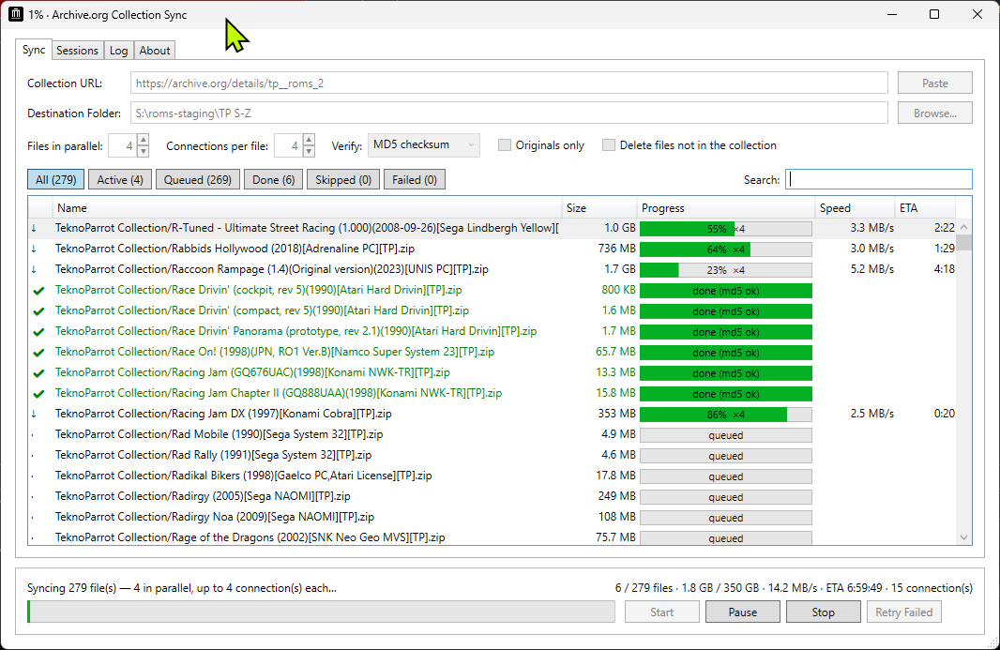

# Archive.org Bulk Downloader: download entire Internet Archive collections, fast and resumable

**Archive.org Bulk Downloader** is a free, open-source Windows app (GUI, no command line). It downloads and syncs whole
**archive.org / Internet Archive** collections and items to a local folder:
- **parallel downloads**, with several files at once and several connections per file;
- **resume** after pause, crash or reboot;
- **MD5 checksum verification**;
- a live, TeraCopy-style file list with speed and ETA.

Paste a collection URL, pick a folder and press Start.

**[⬇ Download the latest release (Windows .exe)](https://github.com/dsync89/archive-org-bulk-downloader/releases/latest)**



> Forked from [Archive.org Collection Sync](https://github.com/jasonunbrokensoftware/ArchiveOrgCollectionSync) by
> Jason / Unbroken Software, LLC. See [Credits](#credits).

## Features

- **Bulk download a whole archive.org collection or item.** Every file listed in the item's `_files.xml` is included,
  and nested folders are kept.
- **Multi-connection (segmented) downloads.** Large files are split into HTTP `Range` segments and fetched over
  several connections at once, like IDM or aria2.
- **Parallel downloads.** Several files download at the same time.
- **Resume interrupted downloads.** Pause, crash, network drop or closing the app keeps `.part` files, and the next
  run continues where it stopped.
- **MD5 checksum verification** against archive.org's own checksums. A corrupt download never overwrites a good file.
- **Sync / mirror mode:**
  - re-running skips files that are already correct;
  - files with the wrong size or checksum download again;
  - optionally, files that are no longer in the collection are deleted.
- **TeraCopy-style progress.** Each file shows status, size, a progress bar, speed and ETA, with filters (Active /
  Queued / Done / Skipped / Failed) and search. Overall speed and ETA show in the bottom bar and on the taskbar.
- **Session history.** Resume, retry failed files, re-run or export to CSV from any past session.
- **Detailed log** with levels, search, copy and save, plus a log file per session.
- **Polite to archive.org.** It retries with backoff and honours `Retry-After` on HTTP 429/503.
- **"Originals only"** skips derivative files (thumbnails, torrents, metadata) that archive.org generates.

## Download and install

1. Download `ArchiveOrgBulkDownloader-<version>-win-x64.exe` from
   [Releases](https://github.com/dsync89/archive-org-bulk-downloader/releases/latest).
2. Make sure the [.NET Desktop Runtime](https://dotnet.microsoft.com/download) 6.0 or newer is installed; 8.0 or 9.0
   is fine. Windows will offer to install it if it's missing.
3. Run the exe. No installer, no admin rights.

## How to use

1. Copy the collection or item URL from archive.org, either `https://archive.org/details/<identifier>` or
   `https://archive.org/download/<identifier>`.
2. Paste it, choose a destination folder and press **Start**.
3. Watch the file list. **Pause** keeps partial files; **Resume** continues; **Retry Failed** re-tries only failures.

### Options

| Option | Default | What it does |
|---|---|---|
| Files in parallel | 4 | 1–16 files downloading at the same time. |
| Connections per file | 4 | 1–16 ranged connections for files of 32 MB or more; smaller files use one. |
| Verify | MD5 checksum | **Size only** is much faster when re-checking a big existing folder. |
| Originals only | on | Skip archive.org-generated derivatives (thumbnails, torrents, `_meta.xml`…). |
| Delete files not in the collection | off | Mirror mode: delete extra files under the destination (in-progress `.part` files are kept). |

## FAQ

### How do I download an entire archive.org collection at once?

Paste the item's `https://archive.org/details/<identifier>` URL, pick a folder and press **Start**. The app reads the
item's file list and downloads every file, keeping nested folders.

### Why are archive.org downloads so slow, and how do I make them faster?

archive.org usually limits the speed of a single connection, so one big file on one connection is slow even on a fast
line. Raise **Connections per file** to split large files over several connections, and **Files in parallel** to
download more files at once.

Start with the defaults (4 × 4) and go up gradually. Beyond a few connections per file your own bandwidth is usually
the limit, and archive.org may throttle very aggressive clients.

### How many connections per file should I use?

4 is a good default; 6 is a sensible maximum for most people. The total number of connections is files ×
connections per file. Watch the speed in the bottom bar and stop increasing once it stops going up.

### Can I resume an interrupted archive.org download?

Yes. Partial data is kept in `<file>.part` with a small `<file>.part.json` progress map. Press **Resume**, use
**Sessions → Resume** after restarting the app, or simply run the same URL again.

### How do I keep a local copy in sync with an archive.org collection?

Run the same URL and folder again. Correct files are skipped, changed or corrupt ones download again, and with
**Delete files not in the collection** your folder mirrors the collection exactly. Use **Verify: Size only** for a
fast re-check.

### How do I check that archive.org downloads aren't corrupt?

With **Verify: MD5 checksum**, every downloaded file is hashed and compared with the MD5 archive.org publishes. A
mismatch is reported as failed and the bad copy is discarded.

### Does it work for ROM, software, video and audio collections?

Yes. It downloads whatever files the item lists, of any type, for example TeknoParrot / MAME / No-Intro ROM sets,
software, videos and music. Only download content you have the right to.

### Does it download from the Wayback Machine?

No. It downloads archive.org **items and collections** (`/details/` and `/download/` URLs), not archived web pages.

## When to use what

- **This app:** a Windows GUI for bulk downloading whole items with parallel and multi-connection downloads, resume,
  MD5 verification and a live file list.
- **[`ia` CLI (internetarchive)](https://github.com/jjjake/internetarchive):** the official Python command-line tool,
  best for scripting, searching and uploading.
- **wget / curl:** fine for a handful of known file URLs from a terminal.
- **JDownloader / IDM:** general-purpose download managers, if you already use one for everything else.

## Where data is stored

| Path | Contents |
|---|---|
| `%LocalAppData%\ArchiveOrgCollectionSync\settings.json` | Last URL, folder and options |
| `%LocalAppData%\ArchiveOrgCollectionSync\sessions\<yyyyMMdd_HHmmss>_<identifier>.json` | Session history (per-file status) |
| `%LocalAppData%\ArchiveOrgCollectionSync\sessions\<…>.log` | Session log (tab-separated) |
| `<destination>\<file>.part`, `.part.json` | In-progress download and its resume map |

## How it works (technical spec)

### Scan

The app fetches `https://archive.org/download/<identifier>/<identifier>_files.xml` and reads each file's `name`,
`source`, `size` and `md5`.

### Download engine (`DownloadEngine.cs`)

- **Shared client.** One `HttpClient` (`SocketsHttpHandler`, pooled connections) with a 60-second idle timeout per
  read and no overall timeout, so multi-GB files never time out.
- **Workers.** A channel of files feeds *N* async workers.
- **Per file:**
  1. Follow the `archive.org/download/...` → `iaNNNNNN.us.archive.org` redirect once.
  2. Split the file into *K* segments.
  3. Each segment streams into its own offset of the preallocated `.part` file (`RandomAccess.WriteAsync`).
  4. Save the segment map every 2 seconds.
- **Retries.** Up to 3 retries with exponential backoff on IO errors, timeouts and HTTP 408/429/5xx, honouring
  `Retry-After`. If a server ignores `Range`, the file falls back to a single stream.
- **Verification.** At most 2 MD5 checks run at once, so downloads keep the line busy. The `.part` file then
  atomically replaces the destination file.

### UI

The UI never blocks the workers. They update thread-safe counters, and a 250 ms timer publishes those to the grid,
the totals and the log.

## Building from source

Requires the .NET SDK 6.0 or newer on Windows.

```
dotnet build ArchiveOrgCollectionSync/ArchiveOrgCollectionSync.csproj -c Release
dotnet publish ArchiveOrgCollectionSync/ArchiveOrgCollectionSync.csproj -c Release -r win-x64 --self-contained false -p:PublishSingleFile=true
```

The About tab shows the version and the git commit it was built from, e.g. `1.3.0 (fe76d11)`.

## Credits

- **Original app:** [Archive.org Collection Sync](https://github.com/jasonunbrokensoftware/ArchiveOrgCollectionSync)
  by Jason / Unbroken Software, LLC. That covers the collection sync concept, the checksum comparison, nested folders,
  the delete-extra-files option and simultaneous downloads.
- **Archive.org Bulk Downloader (1.3+):** [dsync89](https://github.com/dsync89) added the parallel, segmented and
  resumable download engine, the file list, sessions and the log.
- Folder picker: [WindowsAPICodePack](https://www.nuget.org/packages/WindowsAPICodePack).
- Thanks to the [Internet Archive](https://archive.org). Consider [donating](https://archive.org/donate) if you use it
  heavily.

## License

MIT License, unchanged from upstream. See [LICENSE](LICENSE). Copyright (c) Unbroken Software, LLC.

<!-- Keywords: archive.org downloader, internet archive downloader, archive.org bulk download, download entire archive.org collection, archive.org collection downloader, internet archive bulk downloader, archive.org multi-connection downloader, resume archive.org download, archive.org sync, windows -->
